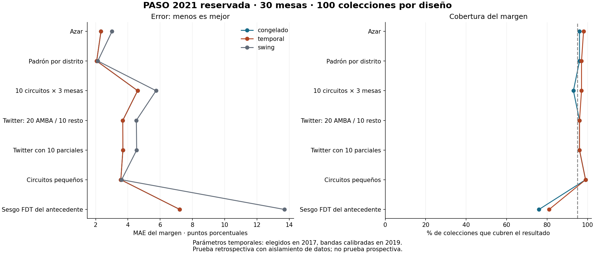

# Validación temporal reservada: PASO 2021

Diputados nacionales, agrupados en cinco familias políticas; no pronostica las internas entre listas de una alianza. Porcentajes sobre votos positivos, que difieren del denominador oficial PASO de votos válidos cuando incluye blancos.

**Estado:** se congeló el código antes de la prueba; se seleccionaron parámetros con 2017, se calibraron bandas con 2019 y se guardaron predicciones antes de abrir el resultado total PASO 2021. No se modificaron los parámetros después de evaluar este destino.

**Límite de la ceguera:** esta es una reconstrucción retrospectiva con aislamiento de datos. La arquitectura, el catálogo de variantes y parte de los diseños ya fueron pensados con conocimiento de 2023/2025. La configuración congelada λ=0,1 y factor=1,4 también tiene esa influencia. La variante temporal vuelve a elegir sus constantes solo con resultados anteriores a septiembre de 2021. Ni esto ni otra semilla convierten la prueba en una predicción hecha en 2021.

## Corte temporal y trazabilidad

- Código previo: `../congelado_20261028/codigo_congelado.zip`, 82 archivos verificados por SHA256; `ENTORNO.json` registra librerías y hash del ZIP.
- `PROTOCOLO.md` y `PROTOCOLO_SELLADO.json`: decisiones y firmas previas a la evaluación. `PARAMETROS_SELLADOS.json`: selección/calibración terminadas antes de predecir 2021. `PREDICCIONES_SELLADAS.json`: hashes de las predicciones anteriores a la apertura del resultado.
- El predictor utilizó solamente diputados generales 2019/2017, padrón reconstruido de claves/electores, y 30 actas reveladas por colección. No abrió las generales de noviembre de 2021 ni elecciones de 2023/2025 ni el total reservado de PASO 2021. Los accesos están en `accesos_prediccion.jsonl`.
- Se comprobaron bloqueos del total reservado y de elecciones posteriores, ausencia de votos en el marco, 30 mesas únicas en las 700 selecciones y que Twitter parcial conserva las mismas mesas que Twitter completo (`CONTROLES.json`). Es una barrera de acceso en el proceso Python, no una garantía de aislamiento adversarial del sistema operativo.
- Los datos se descargan hoy de archivos históricos: no se dispone de una copia de padrón y catálogos fechada antes del 12-sep-2021. Esos campos podían conocerse antes, pero esta reconstrucción no demuestra que cada versión actual del archivo sea idéntica a la publicada entonces.

Fuente oficial de PASO: [DINE, elecciones 2021](https://www.argentina.gob.ar/dine/resultados-electorales/elecciones-2021), ZIP `2021-provisorios_paso.zip`; URL y SHA256 en `../../datos_oficiales/2021_paso/FUENTE.json`.

## Universo y clasificación

Marco territorial con electores nativos y padrón positivo: **99,428 mesas en 24 distritos**, 99,428 actas disponibles. Se contrasta contra los **21,286,049 votos positivos disponibles** de ese universo. No equivale al escrutinio definitivo ni garantiza cobertura de todos los inscriptos.

La agrupación se fijó por nombres sin mirar sus votos: JXC, FDT, FIT, LIB y OTRAS. `config.py` y los CSV `mapeo_*.csv` muestran cada decisión. Las familias históricas son aproximaciones y no idénticas alianzas en todos los años. Por ejemplo, un partido nuevo sin antecedente propio se aprende a partir de las actas recibidas. No se eligieron fuerzas por superar un porcentaje del resultado final. No se incluye ICG, gobernadores, Zipf ni bancas: las PASO no asignan bancas.

## Parámetros elegidos sin el destino

Se probaron λ=0,01; 0,1; 1 y swing (∞) en 2017, con antecedentes 2015/2013, 30 muestras por cada uno de siete diseños. Menor error medio por fuerza; desempate hacia mayor regularización.

| λ | MAE por fuerza en 2017 |
|---|---:|
| 0.01 | 1.986 |
| 0.1 | 1.812 |
| 1.0 | 1.961 |
| swing | 2.234 |

**Variante temporal fijada:** λ=0.1; factor de banda **1.5**. El factor se obtuvo solo con 2019 (antecedentes 2017/2015), a partir del cuantil 95 % de la expansión necesaria del intervalo del margen, sin disminuirlo de 1.

Esto es una única secuencia temporal de desarrollo→calibración→prueba, no muchas elecciones nuevas. La calibración histórica puede fallar si cambian el electorado, la oferta o la selección de mesas.

## Diseños y comparaciones

Se evaluaron **700 colecciones de exactamente 30 mesas**, 100 por diseño, 200 remuestras de circuitos para cada modelo principal. Las mismas actas se usan para todas las variantes. Twitter contiene 20 mesas AMBA y 10 del resto, con racimos; la variante parcial oculta LIB/FIT/OTRAS en las primeras diez. El estrés partidario usa solo el perfil FDT del origen histórico; el geográfico usa tamaño de circuito, nunca el voto de 2021. La disponibilidad de actas se usa como metadato de recepción: se selecciona entre las que tienen algún resultado, sin elegir por partido.

Los baselines crudos calculan medias de proporciones observadas por fuerza (respetando faltantes), sin antecedentes; el ponderado agrega AMBA/resto. Swing emplea antecedentes y regularización infinita. Las ablaciones quitan un antecedente, el repesado o la regularización. No se elige una nueva configuración mirando qué ganó en este cuadro.

| Diseño | Modelo | MAE fuerzas | MAE margen JXC−FDT | Sesgo del margen | MAE distrito | Ganadores /24 |
|---|---|---:|---:|---:|---:|---:|
| Azar | congelado | 1.111 | 2.332 | +0.301 | 5.887 | 16.3 |
| Azar | temporal | 1.111 | 2.332 | +0.301 | 5.887 | 16.3 |
| Azar | swing | 1.388 | 3.018 | -0.204 | 7.680 | 14.8 |
| Azar | crudo | 1.641 | 4.257 | +0.822 | — | — |
| Azar | crudo_ponderado | 1.559 | 4.124 | +0.763 | — | — |
| Azar | solo_2019 | 1.151 | 2.767 | +0.382 | 6.075 | 15.7 |
| Azar | sin_repesado | 1.152 | 2.392 | +0.304 | 5.881 | 16.3 |
| Azar | sin_regularizar | 1.167 | 2.359 | +0.492 | 6.217 | 16.1 |
| Padrón por distrito | congelado | 0.790 | 2.064 | +1.290 | 5.832 | 16.3 |
| Padrón por distrito | temporal | 0.790 | 2.064 | +1.290 | 5.832 | 16.3 |
| Padrón por distrito | swing | 0.841 | 2.135 | +0.695 | 7.622 | 14.7 |
| Padrón por distrito | crudo | 1.077 | 3.422 | +1.965 | — | — |
| Padrón por distrito | crudo_ponderado | 1.098 | 3.388 | +1.915 | — | — |
| Padrón por distrito | solo_2019 | 0.848 | 2.163 | +1.270 | 6.063 | 15.7 |
| Padrón por distrito | sin_repesado | 0.788 | 2.129 | +1.363 | 5.829 | 16.4 |
| Padrón por distrito | sin_regularizar | 0.887 | 2.277 | +1.580 | 6.036 | 16.9 |
| 10 circuitos × 3 mesas | congelado | 2.083 | 4.604 | -1.920 | 6.339 | 15.7 |
| 10 circuitos × 3 mesas | temporal | 2.083 | 4.604 | -1.920 | 6.339 | 15.7 |
| 10 circuitos × 3 mesas | swing | 2.557 | 5.746 | -2.439 | 7.931 | 14.8 |
| 10 circuitos × 3 mesas | crudo | 3.356 | 9.346 | -4.477 | — | — |
| 10 circuitos × 3 mesas | crudo_ponderado | 3.261 | 9.532 | -3.424 | — | — |
| 10 circuitos × 3 mesas | solo_2019 | 2.186 | 5.099 | -2.584 | 6.436 | 15.1 |
| 10 circuitos × 3 mesas | sin_repesado | 2.135 | 4.883 | -1.796 | 6.319 | 15.6 |
| 10 circuitos × 3 mesas | sin_regularizar | 2.796 | 6.418 | -1.740 | 8.284 | 14.1 |
| Twitter: 20 AMBA / 10 resto | congelado | 1.468 | 3.683 | +0.185 | 6.119 | 16.1 |
| Twitter: 20 AMBA / 10 resto | temporal | 1.468 | 3.683 | +0.185 | 6.119 | 16.1 |
| Twitter: 20 AMBA / 10 resto | swing | 1.997 | 4.524 | -0.326 | 7.829 | 15.1 |
| Twitter: 20 AMBA / 10 resto | crudo | 3.031 | 8.006 | -3.379 | — | — |
| Twitter: 20 AMBA / 10 resto | crudo_ponderado | 2.045 | 5.834 | -0.064 | — | — |
| Twitter: 20 AMBA / 10 resto | solo_2019 | 1.468 | 3.773 | +0.151 | 6.266 | 15.4 |
| Twitter: 20 AMBA / 10 resto | sin_repesado | 1.710 | 3.186 | -0.329 | 6.331 | 16.2 |
| Twitter: 20 AMBA / 10 resto | sin_regularizar | 1.647 | 3.743 | +0.396 | 7.379 | 15.5 |
| Twitter con 10 parciales | congelado | 1.449 | 3.689 | +0.188 | 6.108 | 16.1 |
| Twitter con 10 parciales | temporal | 1.449 | 3.689 | +0.188 | 6.108 | 16.1 |
| Twitter con 10 parciales | swing | 1.887 | 4.545 | -0.303 | 7.815 | 15.1 |
| Twitter con 10 parciales | crudo | 2.571 | 7.982 | -3.384 | — | — |
| Twitter con 10 parciales | crudo_ponderado | 2.025 | 5.830 | -0.064 | — | — |
| Twitter con 10 parciales | solo_2019 | 1.456 | 3.778 | +0.155 | 6.247 | 15.4 |
| Twitter con 10 parciales | sin_repesado | 1.477 | 3.208 | -0.310 | 6.172 | 16.3 |
| Twitter con 10 parciales | sin_regularizar | 1.644 | 3.742 | +0.397 | 7.353 | 15.5 |
| Circuitos pequeños | congelado | 1.828 | 3.563 | -2.243 | 5.921 | 15.4 |
| Circuitos pequeños | temporal | 1.828 | 3.563 | -2.243 | 5.921 | 15.4 |
| Circuitos pequeños | swing | 1.985 | 3.611 | -1.387 | 7.497 | 14.7 |
| Circuitos pequeños | crudo | 3.087 | 7.022 | -5.466 | — | — |
| Circuitos pequeños | crudo_ponderado | 2.931 | 7.139 | -4.378 | — | — |
| Circuitos pequeños | solo_2019 | 1.976 | 4.953 | -4.107 | 5.995 | 14.8 |
| Circuitos pequeños | sin_repesado | 1.925 | 3.559 | -2.340 | 5.872 | 15.3 |
| Circuitos pequeños | sin_regularizar | 2.178 | 4.177 | -2.393 | 6.206 | 15.2 |
| Sesgo FDT del antecedente | congelado | 2.787 | 7.215 | +6.625 | 6.510 | 16.3 |
| Sesgo FDT del antecedente | temporal | 2.787 | 7.215 | +6.625 | 6.510 | 16.3 |
| Sesgo FDT del antecedente | swing | 4.590 | 13.703 | +13.703 | 7.759 | 16.1 |
| Sesgo FDT del antecedente | crudo | 7.629 | 34.631 | -34.631 | — | — |
| Sesgo FDT del antecedente | crudo_ponderado | 8.139 | 35.939 | -35.939 | — | — |
| Sesgo FDT del antecedente | solo_2019 | 3.916 | 13.901 | +13.878 | 7.242 | 15.8 |
| Sesgo FDT del antecedente | sin_repesado | 2.723 | 7.927 | +7.619 | 6.612 | 16.1 |
| Sesgo FDT del antecedente | sin_regularizar | 3.656 | 8.274 | +0.695 | 8.135 | 14.4 |

## Cobertura y ancho: modelos principales

Bandas nominales del 95 %. El intervalo Monte Carlo de cobertura usa Wilson para 100 colecciones condicionales a este conjunto electoral fijo; no expresa incertidumbre sobre futuras elecciones. Muestras de diferentes diseños pueden solaparse. El Brier de una sola elección, aun con muchas muestras, no certifica calibración probabilística.

| Diseño | Modelo | Cobertura margen | IC Monte Carlo | Ancho medio | Inferencia disponible | Brier multiclase |
|---|---|---:|---|---:|---:|---:|
| Azar | congelado | 96 % | 90–98 % | 14.17 | 100 % | 0.0088 |
| Azar | temporal | 98 % | 93–99 % | 15.18 | 100 % | 0.0110 |
| Padrón por distrito | congelado | 96 % | 90–98 % | 12.90 | 100 % | 0.0014 |
| Padrón por distrito | temporal | 97 % | 92–99 % | 13.82 | 100 % | 0.0018 |
| 10 circuitos × 3 mesas | congelado | 93 % | 86–97 % | 23.54 | 100 % | 0.1927 |
| 10 circuitos × 3 mesas | temporal | 97 % | 92–99 % | 25.20 | 100 % | 0.1938 |
| Twitter: 20 AMBA / 10 resto | congelado | 96 % | 90–98 % | 19.08 | 100 % | 0.0557 |
| Twitter: 20 AMBA / 10 resto | temporal | 96 % | 90–98 % | 20.42 | 100 % | 0.0605 |
| Twitter con 10 parciales | congelado | 96 % | 90–98 % | 19.10 | 100 % | 0.0557 |
| Twitter con 10 parciales | temporal | 96 % | 90–98 % | 20.45 | 100 % | 0.0603 |
| Circuitos pequeños | congelado | 99 % | 95–100 % | 19.48 | 100 % | 0.0868 |
| Circuitos pequeños | temporal | 99 % | 95–100 % | 20.87 | 100 % | 0.0942 |
| Sesgo FDT del antecedente | congelado | 76 % | 67–83 % | 25.86 | 100 % | 0.0293 |
| Sesgo FDT del antecedente | temporal | 81 % | 72–87 % | 27.57 | 100 % | 0.0335 |

### Error y cobertura por fuerza

Promedio de las 700 colecciones, con igual peso por diseño. La mezcla no sustituye los resultados separados por diseño; el detalle está en `evaluacion_fuerzas.csv`.

| Fuerza | Modelo | MAE | Sesgo | Cobertura 95 % | Ancho medio |
|---|---|---:|---:|---:|---:|
| FDT | congelado | 2.230 | -0.532 | 95.3 % | 11.48 |
| FDT | temporal | 2.230 | -0.532 | 96.0 % | 12.27 |
| FIT | congelado | 0.571 | +0.118 | 96.0 % | 3.34 |
| FIT | temporal | 0.571 | +0.118 | 96.9 % | 3.57 |
| JXC | congelado | 2.116 | +0.100 | 96.3 % | 11.69 |
| JXC | temporal | 2.116 | +0.100 | 97.0 % | 12.52 |
| LIB | congelado | 0.987 | -0.455 | 79.7 % | 3.56 |
| LIB | temporal | 0.987 | -0.455 | 80.6 % | 3.78 |
| OTRAS | congelado | 2.321 | +0.769 | 96.1 % | 13.55 |
| OTRAS | temporal | 2.321 | +0.769 | 96.7 % | 14.49 |

**Fallo relevante:** en circuitos pequeños, LIB se proyectó en promedio en 1,406 % frente a 3,270 % observado. Su banda cubre solo el 29 % de las colecciones; también baja a 74 % en racimos y 68 % con sesgo histórico. La cobertura del margen JXC−FDT por sí sola ocultaría este problema. Bajo sesgo histórico, la cobertura del margen es 81 % con factor temporal 1,5, aun con un ancho medio de 27,6 puntos. No se corrigieron las bandas usando estos errores de 2021.

El MAE distrital promedia por igual los 24 distritos y las cinco fuerzas; no está ponderado por su tamaño. Los modelos secundarios no calculan bandas: su cobertura se deja vacía en los CSV. La enmienda documentada en `ENMIENDAS.md` corrige esa representación del evaluador; conserva todas las predicciones y los parámetros originales.

## Resultado abierto después de predecir

| Fuerza | % del universo evaluado |
|---|---:|
| JXC | 40.749 |
| FDT | 32.270 |
| FIT | 4.727 |
| LIB | 3.270 |
| OTRAS | 18.984 |

Margen JXC−FDT: **+8.479** puntos.

### Primera colección de cada diseño (rep=0, no seleccionada por acierto)

| Diseño | Modelo | Margen proyectado | Error | Banda 95 % |
|---|---|---:|---:|---|
| Azar | congelado | +7.41 | -1.07 | +0.45 a +12.72 |
| Azar | temporal | +7.41 | -1.07 | -0.07 a +13.09 |
| Padrón por distrito | congelado | +7.99 | -0.49 | +3.02 a +15.49 |
| Padrón por distrito | temporal | +7.99 | -0.49 | +2.67 a +16.03 |
| 10 circuitos × 3 mesas | congelado | +11.41 | +2.93 | +5.80 a +15.62 |
| 10 circuitos × 3 mesas | temporal | +11.41 | +2.93 | +5.35 a +15.92 |
| Twitter: 20 AMBA / 10 resto | congelado | +10.10 | +1.63 | +0.23 a +20.96 |
| Twitter: 20 AMBA / 10 resto | temporal | +10.10 | +1.63 | -0.46 a +21.74 |
| Twitter con 10 parciales | congelado | +10.12 | +1.64 | +0.23 a +20.92 |
| Twitter con 10 parciales | temporal | +10.12 | +1.64 | -0.46 a +21.70 |
| Circuitos pequeños | congelado | +7.18 | -1.30 | -5.65 a +17.03 |
| Circuitos pequeños | temporal | +7.18 | -1.30 | -6.50 a +17.66 |
| Sesgo FDT del antecedente | congelado | +19.63 | +11.15 | +9.09 a +31.28 |
| Sesgo FDT del antecedente | temporal | +19.63 | +11.15 | +8.36 a +32.05 |

## Lectura y límites

- congelado: MAE del margen medio entre diseños 3.879; supera a swing en 7/7 diseños y al crudo ponderado en 7/7. Cobertura del margen entre 76 % y 99 %; ancho medio entre 12.9 y 25.9 puntos.
- temporal: MAE del margen medio entre diseños 3.879; supera a swing en 7/7 diseños y al crudo ponderado en 7/7. Cobertura del margen entre 81 % y 99 %; ancho medio entre 13.8 y 27.6 puntos.

La independencia temporal de los datos reduce la fuga directa y el ajuste de constantes al destino. No elimina la influencia del conocimiento previo al diseñar el método ni demuestra validez para toda elección. Una ventaja en esta PASO deberá reproducirse en otros destinos; una desventaja se conserva como resultado. Las bandas se juzgan junto con su ancho y no se recalibran con estos errores.

Las ablaciones tampoco dan una victoria universal a cada componente: en Twitter, quitar el repesado reduce el MAE del margen (3,683→3,186), pero empeora el MAE por fuerza (1,468→1,710). Se conserva la configuración fijada y se informa ese intercambio; no se selecciona una nueva variante con este destino.

Israel prueba otro sistema electoral y puede descubrir fallos de transporte, pero su estructura, oferta partidaria y mecanismos de llegada son distintos. No permite transferir automáticamente a Argentina su calibración de incertidumbre.

**Siguiente evidencia necesaria:** evaluación con otras elecciones no utilizadas para diseñar variantes, y una corrida prospectiva con código congelado y predicciones guardadas antes de conocer el cierre. Esa prueba futura queda pendiente.

Referencias metodológicas: [Cawley y Talbot: sobreajuste en selección de modelos](https://www.jmlr.org/beta/papers/v11/cawley10a.html); [validación anidada, documentación oficial de scikit-learn](https://scikit-learn.org/stable/auto_examples/model_selection/plot_nested_cross_validation_iris.html).

## Reproducción

```powershell
python -X utf8 proyeccion/paso2021_ciego/descargar.py
python -X utf8 proyeccion/paso2021_ciego/preparar.py
python -X utf8 proyeccion/paso2021_ciego/calibrar.py
python -X utf8 proyeccion/paso2021_ciego/custodio.py
python -X utf8 proyeccion/paso2021_ciego/verificar_aislamiento.py
python -X utf8 proyeccion/paso2021_ciego/predecir.py
python -X utf8 proyeccion/paso2021_ciego/evaluar.py
python -X utf8 proyeccion/paso2021_ciego/informe.py
```

No se debe volver a usar esta elección como prueba inédita después de haber leído este informe.


